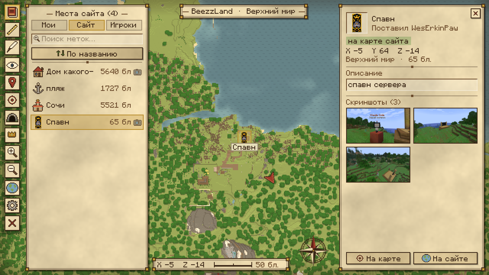
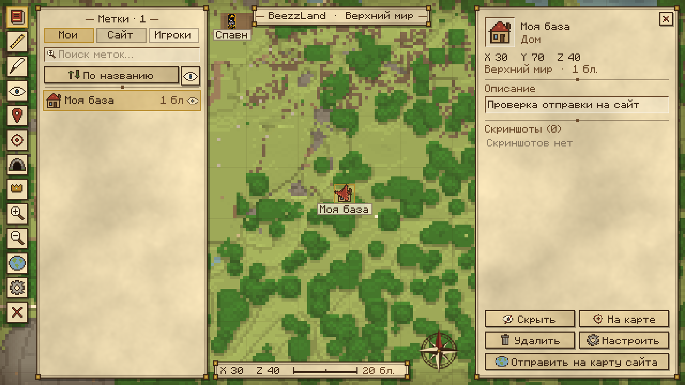
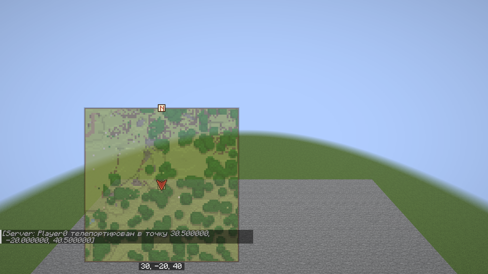
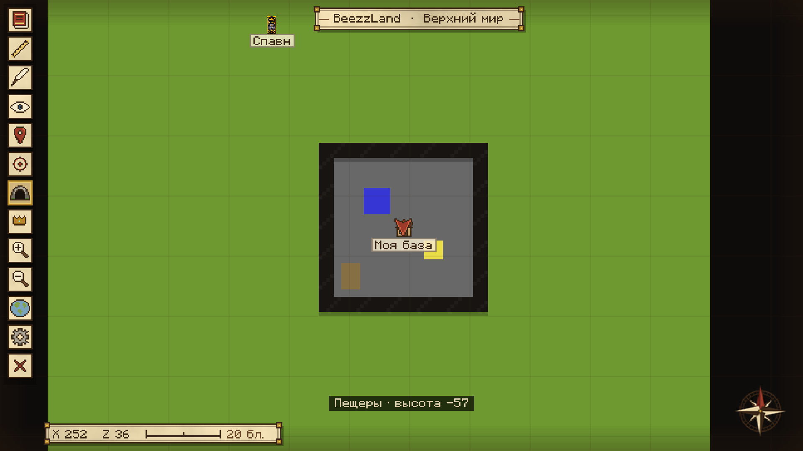

# BeezzMap

Клиентский мод для Fabric (Minecraft 26.3): карта мира и миникарта с метками, скриншотами, линейкой, рисованием,
режимом пещер и восемью вариантами оформления. На сервере **BeezzLand** это карта самого сервера, та же, что на
[play.beezzland.com/map.html](https://play.beezzland.com/map.html): весь исследованный мир, публичные места со
скриншотами, игроки онлайн и туман войны. Свою метку можно отправить на карту сайта прямо из игры.

Мод вырос из MapMinecraft ([erkinpaw/atlasmap](https://github.com/erkinpaw/atlasmap)), и в нём осталось всё, что
умел тот мод.

## Везде

- **Карта** (`M`): рисуется сама, пока ты ходишь по миру. Колесо меняет масштаб. Тянуть карту можно мышью, WASD
  или стрелками.
- **Миникарта** (`N`): квадратная или круглая, ставится в любое место экрана, любого размера и с любой прозрачностью. Настройки →
  «Миникарта: место, размер, масштаб…». Там миникарту тянут мышью, за угол меняют размер, колесом масштаб, а
  кнопками − и + задают непрозрачность. `=` и `-` меняют масштаб прямо в игре.
- **Пещеры** (`K`: выкл / вкл / сам): под землёй карта и миникарта показывают пол пещеры на твоей высоте. В режиме
  «сам» он включается, когда над головой больше 8 блоков.
- **Метки**: правый клик по карте или `B` (метка там, где стоишь). У метки есть название, описание, одна из 183
  иконок любого цвета и скриншоты: из папки скриншотов, через окно выбора файла или перетаскиванием (PNG и JPG).
  Поверх скриншотов можно рисовать.
- **Список меток** (`J`): поиск, сортировка, скрытие. Ещё есть **линейка** (`R`), **рисование** на карте (`G`),
  телепорт к метке (там, где разрешены команды) и атлас карт в главном меню.

## На BeezzLand

- Карта и миникарта показывают тайлы сайта: весь мир, где кто-то был, а не только то, что видел ты сам. Масштаб
  уходит до всего мира сразу. Миры: основной, Незер, Энд и оба мира ферм.
- **Места сайта** видны как метки. Клик по месту показывает описание, автора и скриншоты, а клик по скриншоту
  открывает его на весь экран. В списке меток есть вкладки «Мои», «Сайт» и «Игроки».
- **Игроки онлайн**: на карте видны их головы. Кто скрылся через `/map hide`, того не видно, как и на сайте. Клик
  по голове или по строке в списке включает слежение за игроком.
- **Туман войны**, как на сайте, всегда включён. Пока данные тумана не загрузились, закрыта вся карта, а не
  наоборот.
- **«Отправить на карту сайта»** в карточке своей метки. При первой отправке мод входит на сайт под ником игрока, так
  же как сайт: ты подтверждаешь запрос с тем же номером в боте, к которому привязан ник. Потом уходят скриншоты
  (большие уменьшаются до 6 МБ) и сама метка. Все увидят её после проверки администратором, а до тех пор она видна
  тебе с пометкой «ждёт проверки». Изменённую метку можно отправить ещё раз: на сайте она обновится. Старые метки
  BeezzMap 1.x переносятся в новые сами.







## Что мод берёт с сайта и что отправляет

Читает только то, что видит любой гость сайта:
- `/map/tiles/settings.json`: миры и игроки онлайн, раз в 2 секунды;
- тайлы Pl3xMap;
- `/api/map/points`: места, раз в минуту;
- `/atlas/fog/<мир>.txt`: туман войны, раз в 10 минут;
- `/map-shots/…`: скриншоты мест;
- `/head/<ник>`: головы игроков.

Запросы идут, только пока ты на BeezzLand или открыта его карта.

Отправляет что-то, только когда ты нажимаешь «Отправить на карту сайта»:
- `/api/login`, после чего вход подтверждается в боте;
- `/api/map/upload` со скриншотами;
- `/api/map/add` или `/api/map/edit` с меткой.

Сессия сайта хранится только у тебя, в `config/beezzmap-site-login.json`. Выйти можно в настройках. В самом моде
нет ни ключей, ни паролей, ни служебных адресов.

## Где лежат данные

- `.minecraft/beezzmap/worlds/<id>/`: тайлы, метки (`markers.json`), рисунки и скриншоты меток. Все адреса BeezzLand
  хранятся вместе, в папке `server_beezzland`.
- `.minecraft/beezzmap/site-shots/`: скачанные скриншоты мест.
- `config/beezzmap-settings.json`: настройки.

## Сборка

```
JAVA_HOME=~/.jdks/zulu-25.0.5.1 ./gradlew build
```

Jar: `build/libs/beezzmap-<версия>+26.3.jar`. Нужен Fabric API. Внутрь jar встроен декодер WebP от TwelveMonkeys
(BSD): сайт хранит скриншоты в WebP.

Проверка в настоящем клиенте: `./gradlew runClientGameTest`. Первый тест проходит весь мод в обычном мире: метки,
иконки, цвета, скриншоты, рисование, линейку, темы и телепорт. Второй проходит BeezzLand с живыми данными сайта
(вход на сайт в тесте подменён, на сайт ничего не уходит): карту сайта, места со скриншотами, игроков,
перетаскивание, окно отправки, Незер, пещеры, перенос, размер и прозрачность миникарты. Снимки экрана сохраняются в
`build/run/clientGameTest/screenshots`. С модами из своей сборки: `-PextraMods=<папка с jar>`.

## Лицензия

MIT, автор erkinpaw.
