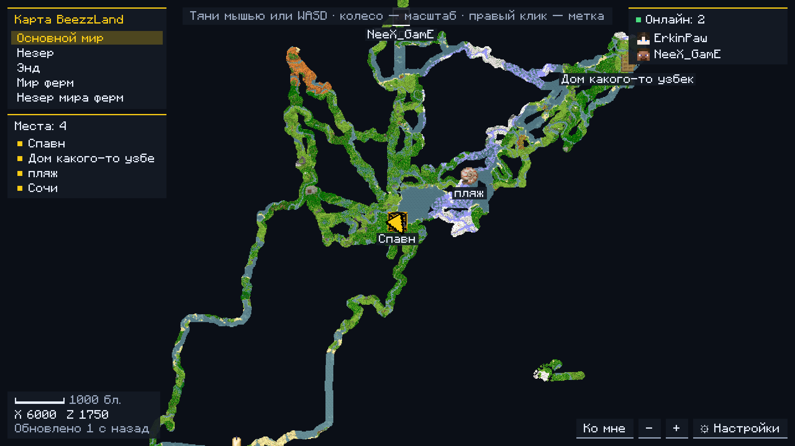
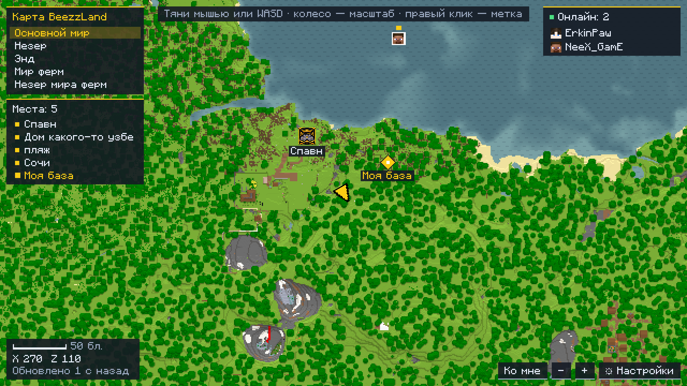
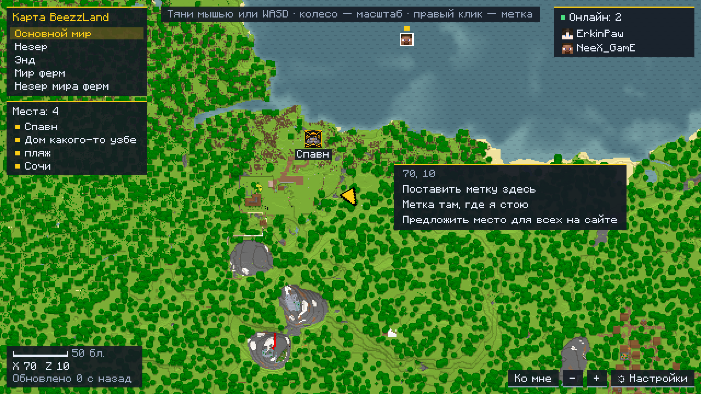
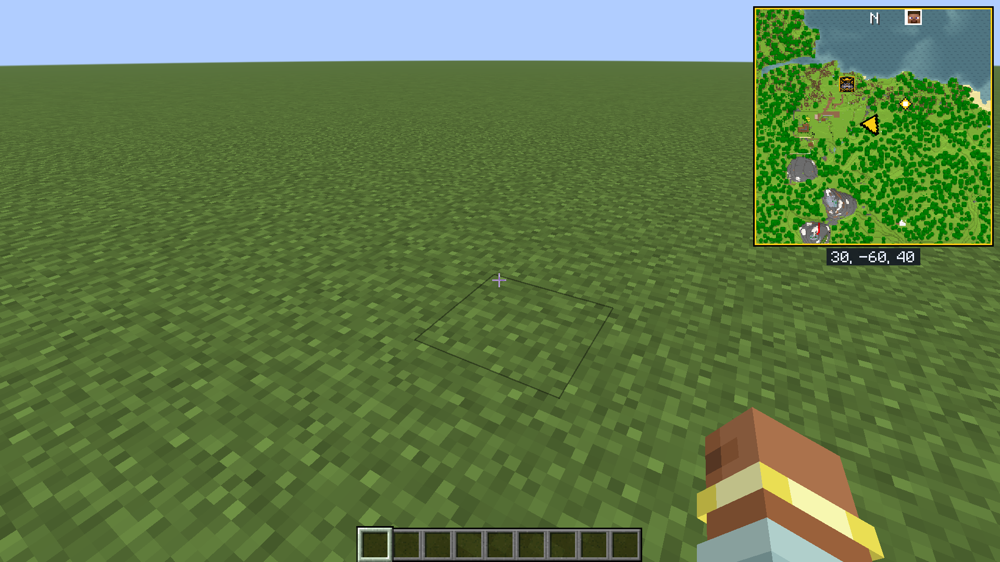

# BeezzMap

Клиентский мод для Fabric (Minecraft 26.3): живая карта мира сервера **BeezzLand** прямо в игре, такая же, как на
[play.beezzland.com/map.html](https://play.beezzland.com/map.html).

- **M** открывает карту на весь экран. Двигать: зажми любую кнопку мыши и тяни, или WASD и стрелки. Масштаб: колесо, `+`/`−`.
- Тайлы мира раскрашены той же формулой, что и на сайте. Темы «BeezzLand» и «Пергамент» — в «⚙ Настройках».
- Публичные места с иконками и описаниями (наведи на точку) и их список слева: клик — перелететь к месту.
- **Свои метки**: правый клик по карте → «Поставить метку здесь» или «Метка там, где я стою», название, цвет, координаты.
  Метки хранятся только у тебя (`config/beezzmap/marks.json`). Место для всех можно предложить на сайте из того же меню.
- Все игроки онлайн: головы на карте и список справа, клик — карта следит за игроком. Кто за краем экрана — его голова
  висит у края и показывает, в какую он сторону.
- Туман войны: закрыто всё, где ещё никто не был. Можно выключить.
- **Миникарта** в правом верхнем углу, пока ты на BeezzLand: места, твои метки, игроки и твоя стрелка.
  `N` — показать/скрыть, `=` и `-` — масштаб, размер — в настройках карты.
- Миры: основной, Незер, Энд, мир ферм.







## Откуда данные

Мод читает публичную карту сайта, ровно то, что видит любой гость:
`/map/tiles/settings.json` (миры и игроки онлайн, раз в 2 секунды), тайлы Pl3xMap `/map/tiles/<мир>/<n>/…`,
`/api/map/points` (одобренные места, раз в минуту), `/atlas/fog/<мир>.txt` (туман, раз в 10 минут) и `/head/<ник>`.
Только GET-запросы и только пока карта открыта. Ни аккаунтов, ни токенов, ничего не отправляется. Кто не хочет
быть на карте, пишет в игре `/map hide`.

## Сборка

```
JAVA_HOME=~/.jdks/zulu-25.0.5.1 ./gradlew build
```

Jar: `build/libs/beezzmap-<версия>+26.3.jar`. Нужен Fabric API.

Проверка в настоящем клиенте с живыми данными сервера: `./gradlew runClientGameTest` — тест открывает карту клавишей M,
ждёт миры, места, туман и тайлы и сохраняет снимки в `build/run/clientGameTest/screenshots`.

## Лицензия

MIT. Внешний вид карты взят из мода MapMinecraft ([erkinpaw/atlasmap](https://github.com/erkinpaw/atlasmap), MIT).
