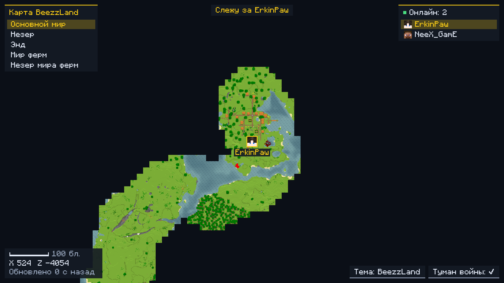
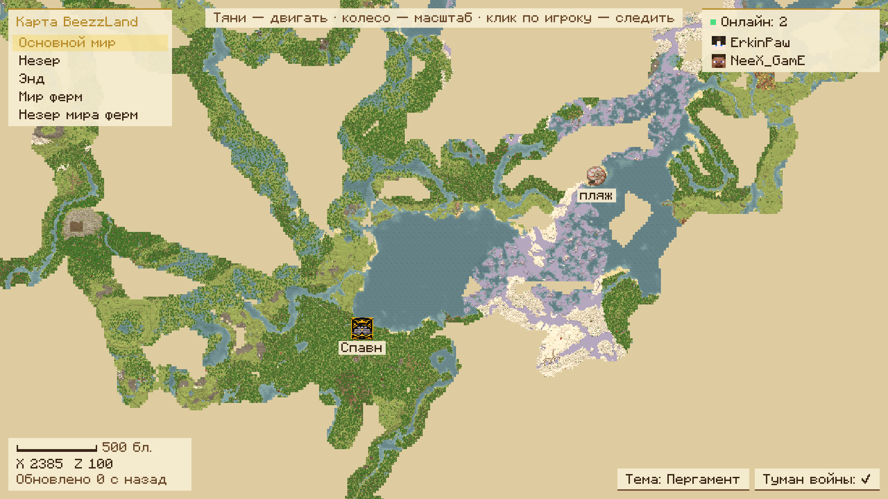

# BeezzMap

Клиентский мод для Fabric (Minecraft 26.3): живая карта мира сервера **BeezzLand** прямо в игре, такая же, как на
[play.beezzland.com/map.html](https://play.beezzland.com/map.html).

- **M** открывает карту (клавишу можно сменить в «Управлении»).
- Тайлы мира раскрашены той же формулой, что и на сайте: тема «BeezzLand» или «Пергамент».
- Публичные места с иконками и описаниями (наведи на точку, чтобы прочитать).
- Все игроки онлайн: головы на карте и список справа. Клик по игроку — карта следит за ним.
- Туман войны: закрыто всё, где ещё никто не был. Можно выключить.
- Миры: основной, Незер, Энд, мир ферм.
- На самом сервере BeezzLand карта показывает и тебя, прямо из игры, без задержки.

Тяни мышью, чтобы двигать карту, колесо меняет масштаб.





## Откуда данные

Мод читает публичную карту сайта, ровно то, что видит любой гость:
`/map/tiles/settings.json` (миры и игроки онлайн, раз в 2 секунды), тайлы Pl3xMap `/map/tiles/<мир>/<n>/…`,
`/api/map/points` (одобренные места, раз в минуту), `/atlas/fog/<мир>.txt` (туман, раз в 10 минут) и `/head/<ник>`.
Только GET-запросы и только пока карта открыта. Ни аккаунтов, ни токенов, ничего не отправляется. Кто не хочет
быть на карте, пишет в игре `/map hide`.

## Сборка

```
JAVA_HOME=~/.jdks/zulu-25.0.5.1 ./gradlew build
```

Jar: `build/libs/beezzmap-<версия>+26.3.jar`. Нужен Fabric API.

Проверка в настоящем клиенте с живыми данными сервера: `./gradlew runClientGameTest` — тест открывает карту клавишей M,
ждёт миры, места, туман и тайлы и сохраняет снимки в `build/run/clientGameTest/screenshots`.

## Лицензия

MIT. Внешний вид карты взят из мода MapMinecraft ([erkinpaw/atlasmap](https://github.com/erkinpaw/atlasmap), MIT).
